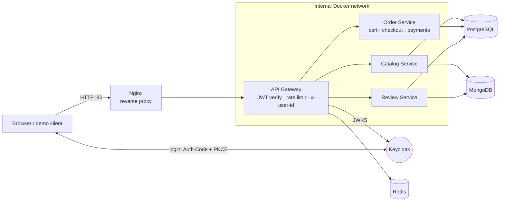

# Grailkits

*A microservice e-commerce backend for a football-jersey marketplace.*

| | |
|---|---|
| **API spec** | [docs/openapi.yaml](docs/openapi.yaml) |
| **Demo client** | `http://localhost` after `docker compose up` - log in via Keycloak, browse, add to cart, check out |
| **Stack** | Node.js, Express, PostgreSQL, MongoDB, Redis, Keycloak, Nginx, Docker Compose |

> Built as an academic project to practise service decomposition, polyglot persistence and OAuth 2.0.
> It is written in Node.js; the same patterns map directly onto Spring (see [Trade-offs](#trade-offs-and-known-limitations)).

## Overview

Customers browse a catalogue of football jerseys, keep a cart, check out, and review products; admins
moderate reviews. The backend is split into four services behind a single gateway, with authentication
handed to Keycloak instead of custom auth code.

The two problems it is built around:

- **Who is calling?** Every request is authenticated once, at the edge, and services trust only the
  identity the gateway derives from a verified token - never one the client claims.
- **Never sell the last jersey twice.** Checkout locks the stock row, checks it and decrements it in one
  database transaction.

## Tech Stack

| Technology | Why it's here |
|---|---|
| **Node.js & Express** | Four small HTTP services with a controller → service → repository structure. |
| **Keycloak** | Identity provider: OAuth 2.0 Authorization Code + PKCE, realm roles (user, admin). |
| **`jose`** | Verifies JWT signatures at the gateway against Keycloak's public keys (JWKS). |
| **`http-proxy-middleware`** | Routes requests from the gateway to each service. |
| **Redis** | Shared rate-limit counters, so the limit holds across gateway instances. |
| **PostgreSQL** | Orders, carts, payments, stock and the relational catalogue - data that needs transactions and row locks. |
| **MongoDB** | Product attributes that vary per item, and document-shaped reviews. |
| **Knex, Sequelize, Prisma, Mongoose** | Data access per service (see trade-offs on the ORM mix). |
| **Jest + Supertest** | ~70 integration tests over HTTP against a real PostgreSQL test database. |
| **Nginx** | Reverse proxy and the single public entry point; serves the demo client. |
| **Docker Compose** | The whole system - services, databases, Redis, Keycloak - with one command. |

## Architecture



**The services**

- **Gateway** - the only service reachable from outside. Verifies the JWT, enforces roles, rate-limits,
  and forwards the caller's identity as an `x-user-id` header taken from the token.
- **Catalog** - products, variants and categories in PostgreSQL; flexible product details in MongoDB.
- **Order** - carts, checkout and payments in PostgreSQL.
- **Review** - reviews in MongoDB; approved reviews update rating statistics on the product.

## Engineering Decisions

- **Authentication at the edge, identity from the token.** The gateway verifies each JWT locally against
  Keycloak's JWKS (no call to Keycloak per request), checks the issuer, then **strips any client-supplied
  `x-user-id` and sets it from the token's `sub`**. Services never accept an identity the caller typed.
- **Public reads, protected writes.** Catalogue and review `GET`s are public; carts, orders, checkout and
  payments require a token; review moderation requires the `admin` realm role.
- **Checkout cannot oversell.** One transaction locks each variant row (`SELECT … FOR UPDATE`), checks
  stock, decrements it and creates the order. Prices come from the locked row, never from the request,
  and the order endpoint rejects client-supplied line items.
- **Rate limiting in Redis.** 100 requests per 15 minutes per IP, with standard `RateLimit-*` headers and
  a `429` body. Counters live in Redis, not gateway memory.
- **Storage chosen per data shape.** Transactional data in PostgreSQL; variable product attributes and
  reviews in MongoDB.
- **Production-like by default.** `docker compose up` exposes only Nginx; services are reachable only
  through the gateway. Direct service ports and live code reload are an explicit opt-in dev mode.
- **Graceful shutdown.** The gateway closes HTTP and Redis connections on `SIGTERM`.

## Testing

```bash
cd apps/catalog-service && npm test   # likewise for order-service and review-service
```

~70 Jest + Supertest tests exercise each service's endpoints over HTTP against a real PostgreSQL test
database (`grailkits_test`, created by `docker/init-test-db.sql`).

## Trade-offs and Known Limitations

- **The services share one PostgreSQL database.** Order locks and updates the catalogue's `variants`
  table directly, and Review writes rating statistics into `products`. This gives checkout a simple local
  ACID transaction, but couples the services through the schema - closer to a distributed monolith than
  true database-per-service. The proper split: each service owns its data, and they coordinate through
  events (`OrderPlaced`, `StockReserved`) published via a transactional outbox, with a saga and
  compensating actions instead of one transaction.
- **Review approval spans two stores.** The review is saved in MongoDB and the statistics in PostgreSQL;
  a crash between the two leaves the statistics stale until the next approval.
- **Services trust the internal network.** They rely on the gateway for authentication; a zero-trust
  setup would validate the JWT in each service or use mTLS between them.
- **No audience (`aud`) check** on tokens yet - only signature, expiry and issuer.
- **Two ORMs in the Order service** (Sequelize for carts and orders, Prisma for payments) - accidental
  complexity worth consolidating.
- **No CI pipeline or centralised logging/tracing yet.**

**How it maps to Java:** Gateway → Spring Cloud Gateway · JWKS verification → Spring Security OAuth2
resource server · Knex/Sequelize/Mongoose → Spring Data JPA / MongoDB · `FOR UPDATE` →
`@Lock(PESSIMISTIC_WRITE)` · rate limiting → Bucket4j + Redis · events → Spring Kafka + outbox.

## Running Locally

Requires Docker and Docker Compose.

```bash
cp .env.example .env          # fill in database, Redis and Keycloak credentials
docker compose up --build     # everything behind Nginx on http://localhost
```

Developer mode - live code reload and direct service ports (3000-3003) for Postman:

```bash
docker compose -f docker-compose.yml -f docker-compose.dev.yml up --build
```

## License

MIT
